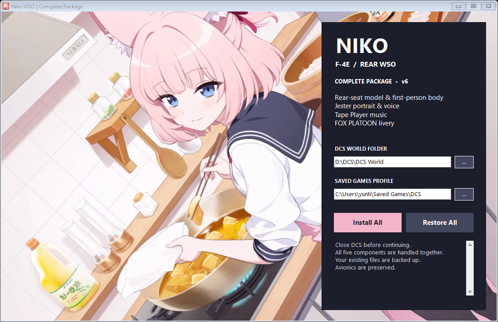

# F4E-Niko WSO

[All projects](../README.md)

**Current stable version: v6**

Complete Niko rear-seat WSO replacement package for the Heatblur F-4E.

## Download

[Download v6](https://github.com/Bishop-611/DCS-BA-MODS/releases/tag/f4e-niko-wso-v6). Select **F4E-Niko.WSO.exe** and its SHA-256 file from the release assets. The executable is also referred to as `F4E-Niko WSO.exe` in the installation guide.

## Included components

- Rear-seat character, external and cockpit models, and first-person body.
- Niko Jester portrait and 15,224 voice files.
- Nine Tape Player tracks with nine sound definitions.
- FOX PLATOON v0.9 livery.

FOX SENSE application and avionics are separate projects.

## Install and restore

1. Close DCS.
2. Run the installer and select the DCS installation and active Saved Games profile.
3. Choose **Install All**.
4. Keep the generated **NikoWSO_Backups** folder. Use **Restore All** to undo the installation.

Existing resources are backed up. Repeated installation preserves the initial backups. Unsupported model versions or conflicting managed-file edits stop installation for review. The installer preserves other avionics modifications when merging its marked script sections.

See [detailed installation instructions](INSTALLATION.txt). If using FOX SENSE, leave its optional portrait replacement unchecked.

## Character and animation

The character retains a 160 cm soles-to-crown scale, excluding ears and halo. LOD3 has 22,000 triangles, LOD4 has 7,499, and LOD5/6 hide the WSO. Native Jester observation and facial channels drive Niko with reduced motion for canopy clearance. Hands and feet follow the original controls. The original rear WSO oxygen mask is removed.

## License

Third-party materials retain their respective terms. See the repository [license](../LICENSE).
